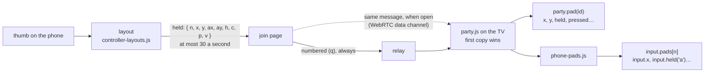
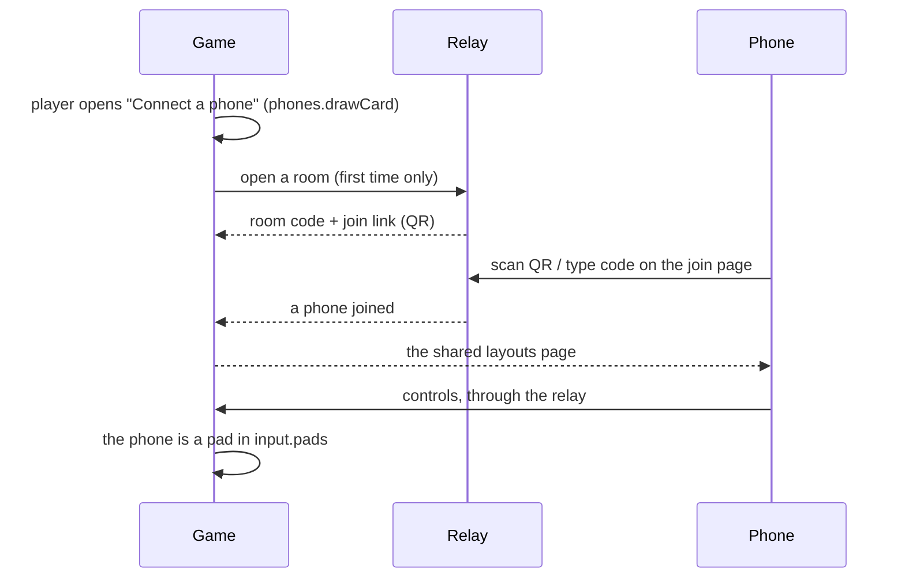

# Phone controllers: the shared layouts

Phones become controllers in two kinds of game:

- **Party games** (`--party`, [party.md](party.md)): everyone plays from a phone, and the TV runs the game.
- **Any other game** (`--phones`, `phone-pads.js`): a phone is one more controller, single-player included.

Either way the phone shows one of the kit's **shared layouts**, the same tested controllers in
every game. The kit keeps them up to date (`pushplay update-runtime`), and a phone that played
one game already has them cached. `pushplay controllers` opens a gallery: press each layout and
watch what the game reads (`--host` opens it on a phone on your Wi-Fi). Write a custom
`controller.html` only when no layout fits ([party.md](party.md), *A custom phone screen*).

## The layouts

| Layout | Phone | The game reads (`party.pad(id)`, or the phone's pad in `input.pads`) | Made for |
|---|---|---|---|
| `classic` | landscape: floating stick, A B X Y | `x`, `y`; `a` `b` `x` `y` | most action games |
| `pad` | landscape: stick, A, B (`classic` with X and Y hidden) | `x`, `y`; `a` `b` | the simplest gamepad |
| `twin` | landscape: two floating sticks, LT and RT along the top | `x`, `y`, `aimX`, `aimY`; `lt` `rt` | twin-stick shooters |
| `dpad` | landscape: 8-way d-pad, A, B | `up` `down` `left` `right`; `x`, `y` in -1/0/1 | retro, puzzle, grid games |
| `tap` | portrait: the whole screen is A | `a`; every finger that lands is a press | rhythm, one-button, reaction |
| `swipe` | portrait: swipe surface | one frame of `up`/`down`/`left`/`right` per swipe (a turn mid-drag is another); a quick tap is `a` | snake, sliding blocks, lanes |
| `slider` | either: a slider and A | `value` 0..1, `x` -1..1 (`vertical: true`: `y`); `spring: true` returns to the middle | paddles, steering, aiming |
| `trackpad` | landscape: trackpad, A, B | `pointer` `{ x, y, dx, dy, down }` (x, y 0..1 across the screen); tap is `a`, two-finger tap `b` | point-and-click, cards, strategy |
| `choices` | portrait: prompt, private card, answers | `{ pick: i }` through `party.on('msg')` | quizzes, votes, hidden roles |
| `motion` | portrait: tilt, wheel, swings, one big button | `motion.js` (`createMotion(party)`, [motion.md](motion.md)) | swinging, steering, motion games |

Every layout has a pause button, read as `pressed('menu')`: pause the game on it. On the sideways
layouts it floats in a spot the layout keeps clear (top centre; on the trackpad, above A and B),
so the sticks and buttons get the whole height under the join page's slim header; the upright
layouts have room for it in a top bar. A layout that wants the phone sideways says so on the
phone, and still works upright.

## Picking and adjusting a layout

The TV picks and can switch at any time, for every phone or for one:

```js
const party = createParty({ input, controls: 'classic' })   // party games: the layout at the start
party.controls({ layout: 'twin', labels: { rt: 'Fire', lt: 'Bomb' } })     // every phone
party.controls({ layout: 'choices', prompt: 'Who did it?', choices: names })  // a vote
party.controls({ card: 'You are the spy', picked: 2 }, id)  // one player: merged over everyone's
party.controls(null, id)                                    // that player back to everyone's

const phones = connectPhones(input, { layout: 'pad', labels: { a: 'Jump' } })   // any game
phones.controls({ layout: 'dpad' })
```

| Setting | |
|---|---|
| `layout` | the name from the table |
| `labels` | `{ a: 'Jump', b: 'Dash' }`: short words (1–6 letters) on the buttons |
| `hide` | `['x', 'y']`: buttons to leave out |
| `pause` | `false` drops the pause button (a game whose TV menus are enough) |
| `prompt`, `card`, `choices`, `picked` | `choices`: the question, this player's private text, the answers (strings, or `{ label }`), which one is picked. `swipe`, `trackpad` show `prompt` as their hint; `motion` shows it on its card |
| `vertical`, `spring` | `slider` |
| `speed` | `trackpad` (default 1) |
| `btn`, `cfg` | `motion`: the big button's label, swing tuning ([motion.md](motion.md)) |
| `theme` | `{ accent, bg, fg, button, font, radius, icons }`, below |

**Theme.** Colours are any CSS colour. The accent defaults to the player's own colour, which
helps people find themselves on the TV: keep that unless the game's look needs one colour.
`font` is one of `system`, `rounded`, `serif`, `mono`, `condensed`, because the phone page has no
network and can't load web fonts. `radius` is 0–50 (% of a button: 50 is round, 20 a rounded
square). `icons` is `{ a: '<svg …>…</svg>' }`: an inline SVG of 2 KB or less per button, drawn in
the button's text colour (`fill="currentColor"`). Anything else is ignored.

Anything beyond settings and theme (a hand of cards, a drawing pad, a typed answer) is a custom
`controller.html`. Layouts are never forked or edited in a game: that is what keeps every game's
phones working the same and getting fixes.

## How a press reaches the game



A layout sends the phone's whole state, never single events, so a lost or late message loses
nothing. Presses are counted on the phone (`c: { a: 3 }`): a tap that went down and up between
two messages still reads as one frame of `pressed('a')`, and the same press never counts twice.
The trackpad sends running totals, so the pointer never jumps on a lost message. `n` is the page's
id: after a phone reloads, counting starts again.

**The direct link.** The relay adds about 50–150 ms. When the phone says it can, `party.js` offers
it a WebRTC data channel through the relay, and once it opens the join page sends each input
message both ways, numbered: the direct copy usually lands first (about 5–20 ms on the same Wi-Fi)
and the relay copy, which always arrives, is dropped as stale. If the channel never opens or drops,
nothing is lost: the relay copy was already on its way. `party.players[i].link` is `'direct'` or
`'relay'`. `createParty({ direct: false })` turns it off; `stun: ['stun:…']` names STUN servers to
try a direct link across networks (none by default, so nothing but the relay is contacted). Only
input takes the channel: the page, the shared state, menus and messages stay on the relay.

## Phones in any game



```js
import { connectPhones } from './phone-pads.js'
const phones = connectPhones(input, { layout: 'pad', labels: { a: 'Jump' }, max: 4 })
// title and pause menus: add phones.menuItem ({ id: 'phones', label: 'Connect a phone' })
// on that screen:        phones.drawCard(ctx, x, y, { size })   (420×540 at size 1)
// nothing per frame: input.update(dt) drives it
```

- The room opens the first time the card is drawn (or `phones.open()`), never at start-up.
- Each phone is a pad in `input.pads` (`pad.virtual` is true), in the merged `input.x` and
  `input.held()` too. A one-player game needs nothing else; a local multiplayer game gets one
  more player per phone.
- A phone that drops fires `input.onPause` and its pad reads `connected: false`. Its seat is kept
  for two minutes.
- `phones.count`, `phones.players`, `phones.padOf(id)`, `phones.code`, `phones.joinUrl`,
  `phones.status`, `phones.close()`, `phones.on('join' | 'leave' | 'away' | 'back', fn)`.
- `pushplay new-game <id> --phones` starts a game with it wired up. An existing game imports
  `./phone-pads.js` and runs `pushplay update-runtime` to get the files.

## Testing

- `pushplay controllers`: every layout, and what the game would read as you press.
- `pushplay dev`: open "Connect a phone" (or the party lobby) and scan the QR code with a phone
  on the same Wi-Fi.
- `pushplay check`: for a party game on a layout, a headless phone presses a button that must
  reach `party.pad(id)`; for a `phone-pads.js` game, a phone joins and its stick must move
  `input.pads`.
